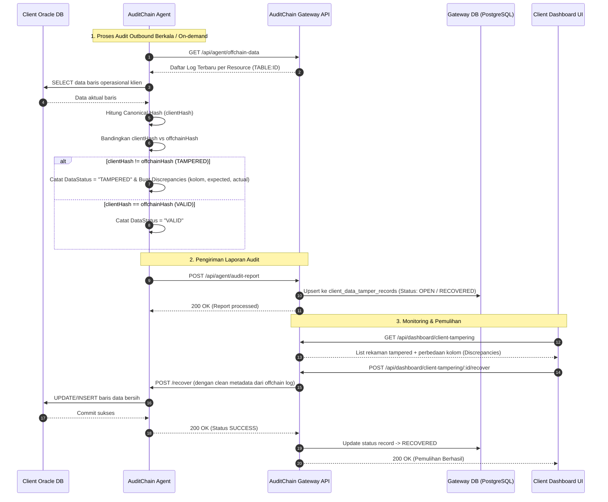
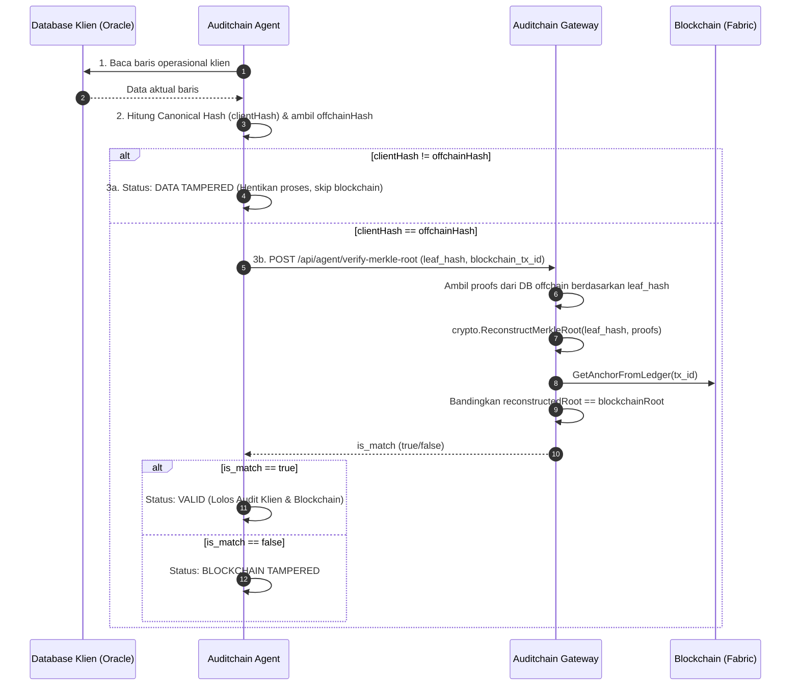

# Dokumentasi Fitur & Arsitektur Client Data Tampering

## 1. Latar Belakang & Definisi Domain

Dalam ekosistem AuditChain, integritas data diawasi pada dua tingkatan independen:

| Dimensi | Offchain Gateway Tampering | Client Data Tampering (Fitur Baru) |
| :--- | :--- | :--- |
| **Tabel Penyimpanan** | `tamper_incidents` | `client_data_tamper_records` |
| **Ruang Lingkup (Scope)** | `GATEWAY_INTEGRITY` | `CLIENT_DATA` |
| **Objek Pembanding** | Hash log audit di PostgreSQL Gateway vs Merkle Root pada Blockchain (Hyperledger Fabric) | **Hash aktual baris data operasional di database klien (Oracle) vs Hash value log terbaru offchain di AuditChain** |
| **Kondisi Tampered** | Terjadi modifikasi ilegal atau anomali pada basis data internal Gateway | Terjadi manipulasi langsung pada database operasional klien di luar mekanisme aplikasi/CDC |
| **Aktor Pemeriksa** | AuditChain Gateway Internal Tamper Scanner | AuditChain Agent (Outbound Audit Sweep) |

> [!IMPORTANT]
> **Klarifikasi Domain:**
> *Tampered Client Data* terjadi secara spesifik saat membandingkan **hash aktual data klien (canonical hash)** terhadap **hash value dari log audit terbaru yang tercatat secara offchain di AuditChain Gateway** (`clientHash != offchainHash`). Jika nilai hash tidak sama, maka baris data klien tersebut ditandai sebagai **TAMPERED**.

---

## 2. Arsitektur & Alur Kerja (Workflow)



---

## 3. Skema Basis Data: `client_data_tamper_records`

Tabel ini secara khusus memisahkan insiden data klien dari tabel `tamper_incidents` (yang dikhususkan untuk log internal Gateway).

```sql
CREATE TABLE client_data_tamper_records (
    id VARCHAR(36) PRIMARY KEY,
    client_id VARCHAR(36) NOT NULL,
    run_id VARCHAR(36),
    resource VARCHAR(255) NOT NULL,       -- Format "TABLE:ID" (misal: "SATUPETA_POLYGON:1001")
    table_name VARCHAR(100) NOT NULL,     -- Nama tabel operasional klien
    record_id VARCHAR(100) NOT NULL,      -- Primary key baris data klien
    log_id VARCHAR(100) NOT NULL,         -- Log ID offchain pembanding terbaru
    action VARCHAR(30),                   -- INSERT / UPDATE / DELETE
    expected_hash VARCHAR(64) NOT NULL,   -- Hash value dari log offchain AuditChain
    actual_hash VARCHAR(64) NOT NULL,     -- Hash kanonikal data lokal database klien saat ini
    discrepancies JSONB,                  -- Array rincian kolom yang berbeda
    blockchain_tx_id VARCHAR(128),        -- ID transaksi blockchain terkait
    status VARCHAR(30) NOT NULL DEFAULT 'OPEN', -- 'OPEN' | 'RECOVERED' | 'DISMISSED'
    auto_recovered BOOLEAN NOT NULL DEFAULT FALSE,
    recovery_error TEXT,
    detected_at TIMESTAMP WITH TIME ZONE NOT NULL,
    last_confirmed_at TIMESTAMP WITH TIME ZONE,
    resolved_at TIMESTAMP WITH TIME ZONE,
    resolved_by VARCHAR(100),             -- User / 'agent_auto_recovery' / 'agent_audit_verified'
    resolution_notes TEXT
);

CREATE INDEX idx_client_tamper_client_status ON client_data_tamper_records (client_id, status);
CREATE INDEX idx_client_tamper_resource ON client_data_tamper_records (client_id, resource);
CREATE INDEX idx_client_tamper_detected_at ON client_data_tamper_records (detected_at);
```

### Penjelasan Status:
- `OPEN`: Data operasional klien saat ini berbeda dengan hash log audit offchain (sedang terkompromi).
- `RECOVERED`: Data operasional klien telah disinkronkan kembali atau dipulihkan sehingga hash kembali cocok.
- `DISMISSED`: Insiden telah ditinjau oleh administrator klien dan sengaja diabaikan dengan catatan alasan.

---

## 4. Spesifikasi API Endpoint

Seluruh endpoint dashboard berada di bawah `/api/dashboard/client-tampering` dan mewajibkan otentikasi JWT Bearer (`client_id` diambil dari payload token).

### 4.1. Mengambil Daftar Tampered Client Data
- **Method & Path:** `GET /api/dashboard/client-tampering`
- **Query Parameters:**
  - `status` *(string, opsional)*: `OPEN`, `RECOVERED`, `DISMISSED`, atau `ALL`.
  - `table_name` *(string, opsional)*: Filter berdasarkan nama tabel operasional (contoh: `SATUPETA_POLYGON`).
  - `resource` *(string, opsional)*: Filter berdasarkan resource spesifik (`TABLE:ID`).
  - `search` *(string, opsional)*: Pencarian teks pada kolom resource, record_id, atau table_name.
  - `page` *(int, opsional, default: 1)*: Halaman data.
  - `page_size` *(int, opsional, default: 10)*: Jumlah item per halaman (maksimal 100).
- **Contoh Respons (200 OK):**
```json
{
  "records": [
    {
      "id": "e6745100-36a5-4899-b1d4-874288c3a101",
      "client_id": "c1f7a28e-87ef-4a64-b03a-3304dfdf1a22",
      "run_id": "run-2026-10-21-01",
      "resource": "SATUPETA_POLYGON:1001",
      "table_name": "SATUPETA_POLYGON",
      "record_id": "1001",
      "log_id": "LOG-OFFCHAIN-8819",
      "action": "UPDATE",
      "expected_hash": "a1b2c3d4e5f67890abcdef1234567890abcdef1234567890abcdef1234567890",
      "actual_hash": "f9e8d7c6b5a43210fedcba0987654321fedcba0987654321fedcba0987654321",
      "discrepancies": "[{"field":"LUAS","expected":1500,"actual":2500},{"field":"STATUS","expected":"DISETUJUI","actual":"DRAFT"}]",
      "blockchain_tx_id": "0x3f8a92bc1047de71...",
      "status": "OPEN",
      "auto_recovered": false,
      "detected_at": "2026-10-21T03:45:00Z",
      "last_confirmed_at": "2026-10-21T04:15:00Z"
    }
  ],
  "total": 1,
  "page": 1,
  "page_size": 10,
  "total_pages": 1,
  "summary": {
    "open_count": 1,
    "recovered_count": 0,
    "dismissed_count": 0,
    "total_count": 1
  }
}
```

---

### 4.2. Mengambil Detail Insiden Tamper Tertentu
- **Method & Path:** `GET /api/dashboard/client-tampering/:id`
- **Contoh Respons (200 OK):**
Mengembalikan objek lengkap `ClientDataTamperRecord` termasuk JSON string `discrepancies`.

---

### 4.3. Melakukan Pemulihan (Recovery) Data Klien
- **Method & Path:** `POST /api/dashboard/client-tampering/:id/recover`
- **Deskripsi:** 
  1. Gateway memverifikasi rekaman tamper berstatus `OPEN`.
  2. Gateway mengambil `AuditLog` offchain terverifikasi terkait `log_id` / `resource`.
  3. Gateway membaca payload `Metadata` bersih dan memanggil endpoint `POST /recover` pada Agent klien melalui koneksi aman.
  4. Agent melakukan operasi atomic `UPDATE` atau `INSERT` pada database Oracle klien.
  5. Setelah sukses, Gateway memperbarui status rekaman tamper menjadi `RECOVERED` dan menandai `source_integrity_status` pada log menjadi `VALID`.
- **Contoh Respons (200 OK):**
```json
{
  "record": {
    "id": "e6745100-36a5-4899-b1d4-874288c3a101",
    "status": "RECOVERED",
    "resolved_at": "2026-10-21T04:30:15Z",
    "resolved_by": "operator_client"
  },
  "result": {
    "status": "SUCCESS",
    "table": "SATUPETA_POLYGON",
    "id": "1001",
    "operation": "UPDATE",
    "recovered_columns": ["LUAS", "STATUS"]
  },
  "message": "Data berhasil dipulihkan pada database klien"
}
```

---

### 4.4. Mengabaikan (Dismiss) Insiden Tamper
- **Method & Path:** `POST /api/dashboard/client-tampering/:id/dismiss`
- **Request Body (JSON):**
```json
{
  "notes": "Perubahan nilai telah diverifikasi manual melalui Berita Acara No. BA-882/2026"
}
```
- **Contoh Respons (200 OK):**
Mengembalikan objek rekaman dengan status `DISMISSED`, `resolved_at`, `resolved_by`, dan `resolution_notes`.

---

### 4.5. Penerimaan Laporan Audit dari Agent
- **Method & Path:** `POST /api/agent/audit-report`
- **Autentikasi:** JWT Bearer (Token Agent Klien)
- **Fungsi:** Menerima hasil audit outbound dari Agent:
  - Jika `item.DataStatus == "TAMPERED"`: Secara otomatis membuat atau memperbarui entri di `client_data_tamper_records` dengan status `OPEN` (atau `RECOVERED` jika `item.AutoRecovered == true`).
  - Jika `item.DataStatus == "VALID"`: Secara otomatis menutup insiden `OPEN` untuk resource terkait dan mengubah statusnya menjadi `RECOVERED`.

---

## 5. Dokumentasi Swagger

Dokumentasi OpenAPI / Swagger UI telah di-update secara otomatis dan dapat diakses pada:
- **AuditChain Gateway API:** `http://localhost:8080/swagger/index.html` (Tag: `Client Tampering`)
- **AuditChain Agent:** `http://localhost:8083/swagger/index.html` (Tag: `Recovery`, `Audit`, `Verification`)


---

## 6. Pemisahan Ranah Audit & Statistik: Audit Internal vs Audit External

Sistem membedakan secara tegas antara **Audit Internal** dan **Audit External** demi mencegah pencampuran metrik integritas offchain dengan anomali data operasional klien:

### 6.1. Definisi Ranah (Domain Separation)

| Ranah Audit | Objek yang Diaudit | Alur Verifikasi | Eksekutor | Indikator Statistik |
| :--- | :--- | :--- | :--- | :--- |
| **Audit Internal (Offchain Gateway)** | Log transaksi offchain di PostgreSQL AuditChain | Membandingkan hash kanonikal baris `audit_logs` dan rekonstruksi pohon Merkle (`leaf_hash` + Merkle proofs) dengan Merkle root yang tercatat di Blockchain Hyperledger Fabric. Tidak menyentuh database operasional klien. | Gateway / Background Verifier (`VerificationJobService`) | `internal_audit` (`internal_total_verifications`, `internal_total_tampered`, `internal_integrity_score`) |
| **Audit External (Data Klien)** | Data baris aktual di database operasional klien (misal: Oracle Satupeta) | 1. Membandingkan hash aktual data klien (`clientHash`) vs hash log offchain (`offchainHash`).<br>2. **Jika hash TIDAK cocok:** Proses verifikasi dihentikan seketika, status dicatat `TAMPERED`, dan panggilan ke blockchain di-skip.<br>3. **Jika hash COCOK:** Lanjut memanggil API `POST /api/agent/verify-merkle-root` membawa `leaf_hash` data klien. Gateway merekonstruksi Merkle root dari `leaf_hash` + `merkle_proofs` lalu mencocokkannya dengan Merkle root di ledger blockchain. | `auditchain-agent` yang berjalan di sisi klien | `external_audit` (`external_total_audited`, `external_total_tampered`, `external_integrity_score`, `client_data_tamper_records`) |

### 6.2. Alur Rekonstruksi Merkle Proof pada Audit External


### 6.3. Pemisahan Metrik pada Endpoint `GET /api/dashboard/stats`
Respons statistik dashboard memisahkan objek `internal_audit` dan `external_audit` secara bersih:
```json
{
  "total_logs": 1250,
  "anchored_logs": 1250,
  "pending_logs": 0,
  "data": {
    "client_id": "c1f7a28e-87ef-4a64-b03a-3304dfdf1a22",
    "total_logs": 1250,
    
    "internal_audit": {
      "total_verifications": 1250,
      "total_valid": 1250,
      "total_tampered": 0,
      "total_pending": 0,
      "integrity_score": 100.0,
      "last_verified_at": "2026-10-22T04:20:00Z"
    },

    "external_audit": {
      "total_audited": 100,
      "total_valid": 99,
      "total_tampered": 1,
      "total_pending": 0,
      "integrity_score": 99.0,
      "last_audited_at": "2026-10-22T04:25:00Z",
      "table_verify_results": {
        "SATUPETA_POLYGON": {
          "total": 100,
          "valid": 99,
          "invalid": 1,
          "pending": 0
        }
      }
    },

    "total_verifications": 1350,
    "total_valid": 1349,
    "total_tampered": 1,
    "integrity_score": 99.92
  }
}
```
